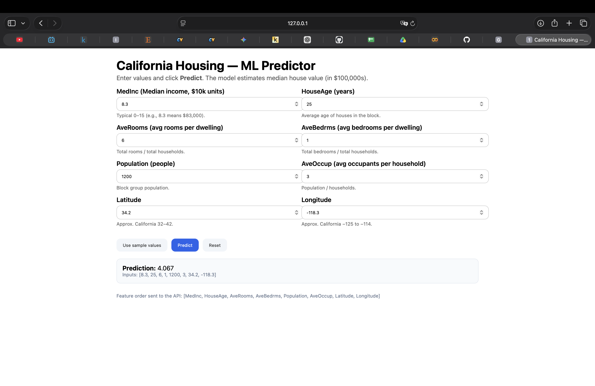

# ML Service: Model as a Service ด้วย Flask และ Docker

## 1. วัตถุประสงค์

โปรเจคนี้เป็นตัวอย่างการสร้างระบบ Machine Learning แบบ Model as a Service โดยใช้ Flask เพื่อให้บริการการทำนายราคาบ้านใน California Housing Dataset และใช้ Docker เพื่อรันแอปพลิเคชันในสภาพแวดล้อมเดียวกันทุกเครื่อง

- ทำความเข้าใจแนวคิด Model as a Service
- สร้างระบบทำนายจากโมเดล Machine Learning
- ใช้ Flask เพื่อให้บริการ API และหน้าเว็บ
- ใช้ Docker เพื่อ build และ run แอปพลิเคชัน
- เผยแพร่โค้ดบน GitHub พร้อมเอกสารอธิบายการใช้งาน

---

## 2. โครงสร้างโปรเจค

```text
ml_service/
├─ app.py
├─ train_model.py
├─ requirements.txt
├─ Dockerfile
├─ .gitignore
├─ README.md
├─ model/
│  └─ model.pkl
├─ templates/
│  └─ main.html
└─ .venv/   (ถ้าทำการสร้าง virtual environment แล้ว)
```

- `train_model.py` ใช้สำหรับฝึกโมเดลและบันทึกเป็นไฟล์ `model.pkl`
- `app.py` เป็นแอป Flask ที่ให้บริการ API และหน้าเว็บ
- `templates/main.html` เป็นหน้าเว็บสำหรับใส่ค่าฟีเจอร์และทดสอบการทำนาย
- `model/` เป็นโฟลเดอร์เก็บโมเดลที่ถูกสร้างจากการฝึกโมเดล

---

## 3. การติดตั้งและตั้งค่าภูมิหลัง

### 3.1 สร้าง virtual environment

เปิด Terminal ในโฟลเดอร์ `ml_service` แล้วรันคำสั่งต่อไปนี้

```bash
cd ml_service
python3 -m venv .venv
source .venv/bin/activate
```

> หากใช้ Windows PowerShell ให้ใช้คำสั่ง:
>
> ```powershell
> cd ml_service
> python -m venv .venv
> .\.venv\Scripts\Activate.ps1
> ```

### 3.2 ติดตั้ง dependencies

```bash
pip install -r requirements.txt
```

หากต้องการตรวจสอบว่า package ถูกติดตั้งครบแล้ว ให้เรียกดูไฟล์ `requirements.txt`:

```text
flask==3.1.3
gunicorn==26.2.0
numpy==2.4.6
scikit-learn==1.9.1
joblib==1.6.0
pandas==3.1.1
```

---

## 4. การฝึกและบันทึกโมเดล

รันไฟล์ต่อไปนี้เพื่อฝึกโมเดลและบันทึกลงในโฟลเดอร์ `model/`

```bash
python train_model.py
```

ผลลัพธ์ที่คาดหวัง:

```text
บันทึกโมเดลเรียบร้อยที่ model/model.pkl
```

เมื่อลองรันสำเร็จ จะมีไฟล์ดังนี้ในโฟลเดอร์ `model/`

```text
model/model.pkl
```

---

## 5. วิธี Run แอปพลิเคชันด้วย Flask

### 5.1 Start แอปพลิเคชัน

จากโฟลเดอร์ `ml_service` ให้รันคำสั่งดังนี้

```bash
python app.py
```

ถ้าใช้งานใน environment ที่เปิดใช้งาน venv แล้ว จะใช้คำสั่งนี้

```bash
source .venv/bin/activate
python app.py
```

เมื่อแอปทำงานแล้ว จะเห็นข้อความแบบนี้

```text
* Running on http://127.0.0.1:5000
```

### 5.2 เปิดหน้าเว็บ

เปิดเบราว์เซอร์แล้วเข้าไปที่

```text
http://127.0.0.1:5000/
```

จะเห็นหน้าเว็บสำหรับกรอกข้อมูล 8 ฟีเจอร์ เช่น

- MedInc
- HouseAge
- AveRooms
- AveBedrms
- Population
- AveOccup
- Latitude
- Longitude

แล้วกดปุ่ม Predict เพื่อดูผลลัพธ์

### 5.3 ตรวจสอบ Health API

เปิด url ต่อไปนี้เพื่อเช็คสถานะของระบบ

```text
http://127.0.0.1:5000/health
```

ผลลัพธ์ที่ได้จะเป็น JSON เช่น

```json
{
  "ok": true,
  "features": [
    "MedInc",
    "HouseAge",
    "AveRooms",
    "AveBedrms",
    "Population",
    "AveOccup",
    "Latitude",
    "Longitude"
  ]
}
```

---

## 6. การทดสอบ API ด้วย JSON

สามารถเรียก API แบบ JSON ได้ด้วยคำสั่งดังนี้

```bash
curl -X POST http://127.0.0.1:5000/predict \
  -H "Content-Type: application/json" \
  -d '{"features":[8.3,25.0,6.0,1.0,1200,3.0,34.2,-118.3]}'
```

ผลลัพธ์ที่ได้ประมาณ:

```json
{
  "prediction": 4.066552199999995
}
```

หมายเหตุ: ค่าที่ได้อาจมีความแตกต่างเล็กน้อยตามเครื่องและเวอร์ชันของ scikit-learn แต่จะอยู่ในช่วงประมาณเดียวกัน

---

## 7. วิธี Run ด้วย Docker

### 7.1 Build Docker image

จากโฟลเดอร์ `ml_service` รันคำสั่ง

```bash
docker build -t ds-ml-service .
```

### 7.2 Run container

```bash
docker run --rm -p 5000:5000 ds-ml-service
```

### 7.3 ตรวจสอบเว็บ

เปิดเบราว์เซอร์แล้วเข้าไปที่

```text
http://127.0.0.1:5000/
```

และตรวจสอบ health endpoint ที่

```text
http://127.0.0.1:5000/health
```

---

## 8. ตัวอย่างภาพหน้าจอ (Screenshot)

## ผลลัพธ์การทำนาย

ภาพด้านล่างแสดงหน้าเว็บที่รับค่า input และแสดงผล prediction สำเร็จ



---

## 9. ปัญหาที่พบบ่อยและวิธีแก้ไข

### ปัญหา: `FileNotFoundError: model.pkl`

สาเหตุ: ยังไม่ได้รัน `python train_model.py`

วิธีแก้:

```bash
python train_model.py
```

### ปัญหา: `TemplateNotFound: main.html`

สาเหตุ: ไฟล์ HTML ไม่อยู่ในโฟลเดอร์ `templates/`

วิธีแก้:

- ตรวจสอบว่า `templates/main.html` ถูกสร้างอยู่
- ตรวจสอบว่า `app = Flask(__name__, template_folder="templates")`

### ปัญหา: `gunicorn: not found`

สาเหตุ: ยังไม่ได้ติดตั้ง package `gunicorn` จาก `requirements.txt`

วิธีแก้:

```bash
pip install -r requirements.txt
```

### ปัญหา: Port 5000 ถูกใช้งานแล้ว

วิธีแก้:

```bash
docker run --rm -p 8080:5000 ds-ml-service
```

หรือหากรัน Flask แบบ local ให้เปลี่ยน port โดยแก้ในไฟล์ app.py:

```python
app.run(host="0.0.0.0", port=8080, debug=True)
```

---


## 10. สรุป

โปรเจคนี้แสดงให้เห็นว่า Machine Learning Model สามารถถูกทำให้เป็น Service ได้โดยใช้ Flask และ Docker ซึ่งช่วยให้การใช้งานโมเดลทำได้ง่ายและสามารถนำไปใช้งานจริงในระบบสาธารณะได้

หากต้องการทดสอบแบบเร็วที่สุด ให้ทำตามลำดับต่อไปนี้:

```bash
cd ml_service
python3 -m venv .venv
source .venv/bin/activate
pip install -r requirements.txt
python train_model.py
python app.py
```

จากนั้นเปิดเบราว์เซอร์ที่:

```text
http://127.0.0.1:5000/
```

และทำการทดสอบผลลัพธ์ที่หน้าเว็บจนได้ prediction ที่แสดงผลสำเร็จ
